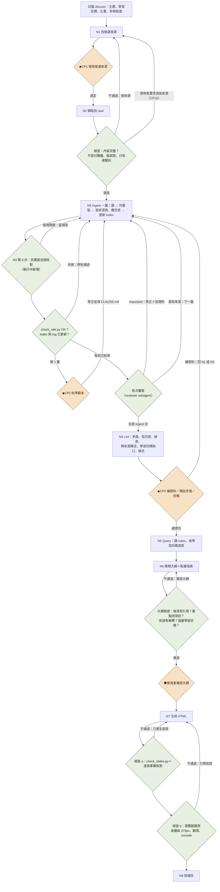

# 繳交報告：咖啡入門 LLM Wiki ＋ 教學 HTML 簡報

> **繳交標題格式（請自行填寫）：** `學校 學號 系級 姓名 主題`

**使用工具：** Claude Code（依 `CLAUDE.md` 執行 graph，不用 LangGraph／API key）；獨立審查用 Claude Code subagent（reviewer）；Python 檢查腳本 `scripts/check_wiki.py`、`scripts/check_slides.py`；Wiki 是 Obsidian 相容的 markdown（標準相對連結）；簡報是手寫單檔 HTML。

本報告的數字與引文都來自 [`wiki/log.md`](wiki/log.md)、git 紀錄與 repo 內的檔案；只出現在審查紀錄（SDD 進度紀錄，`.superpowers/` 未提交）的事會特別註明。

---

## 1. LLM Wiki 主題與簡短介紹

**主題：咖啡入門。** 觀眾原本不懂咖啡。

**學習目標：** 看完的人走進精品咖啡店，看得懂菜單和豆子標籤，知道怎麼點到自己會喜歡的咖啡。

做法參考 Karpathy 的「LLM Wiki」構想，三層架構：

1. `raw/`：擷取下來的原文，**不可修改**；全文因版權只留本機（gitignore），公開的只有 [`raw/SOURCES.md`](raw/SOURCES.md)。
2. `wiki/`：由 LLM（Claude Code）維護、互相連結的 markdown：來源摘要頁、概念頁、產出頁、目錄與 log。
3. [`CLAUDE.md`](CLAUDE.md)：schema，規定頁面格式、8 個節點的 graph、每個節點的檢查與失敗處理。執行中改過 3 次規則，記在它的第 10 節。

流程是「先討論、後生成」：先和使用者討論主題、學習目標、內容比重與參與程度（log 第一筆 `discuss | 需求與設計討論`），才開始找來源。內容比重：菜單飲品（重）、豆子標籤（重）、烘焙度（中）、風味輪（中）、沖煮方式（輕，不教操作），最後收在點餐決策樹。Wiki 是簡報唯一的知識來源。

## 2. LLM Wiki 連結與成果

- **Wiki（GitHub repo）：** {{REPO_URL}}
- **入口：** [`wiki/index.md`](wiki/index.md)（目錄，每頁一行摘要）、[`wiki/overview.md`](wiki/overview.md)（依學習目標分組的導覽）、[`wiki/log.md`](wiki/log.md)（只增不改的操作紀錄）

**規模（`check_wiki.py` 最後結果 `OK: 39 pages`）：**

| 類型 | 頁數 | 內容 |
|---|---|---|
| 來源頁 `wiki/sources/` | 11 | 10 篇來源；About Coffee 拆成烘焙、沖煮兩頁，所以是 11 頁 |
| 概念頁 `wiki/concepts/` | 23 | 菜單飲品 10、豆子標籤 9、烘焙度 1、風味輪 1、沖煮方式 2 |
| 產出頁 `wiki/outputs/` | 2 | 點餐指南（synthesis）、簡報大綱（output） |
| 目錄／總覽／log | 3 | `index.md`、`overview.md`、`log.md` |
| **合計** | **39** | |

**來源（10 篇，詳見 `raw/SOURCES.md`）：** Seattle Coffee Gear 兩篇（飲品指南、豆袋怎麼讀）、La Marzocco 飲品入門、Nespresso 台灣三篇專文（算一篇來源）、香港01 手沖 5 件事、Coffee Hero 處理法、Wikipedia 咖啡品種、About Coffee（美國國家咖啡協會）烘焙與沖煮、SCA 風味輪八步驟、Trade 風味輪解說。中英文混合，官方（SCA、NCA）、百科、器材商、媒體都有，方便交叉比對。使用者一共選了 12 篇，後來為了加速刪掉 2 篇尚未 ingest 的（Urnex、WCR Sensory Lexicon），見 log `discuss | 精簡來源`。

**頁面慣例：** 每個概念頁都是「定義 → 重點 → 相關概念 → 來源間的差異」；每個事實行內標註來源簡稱（例如「（Seattle 豆袋）」）；來源矛盾時寫「A 說……，B 說……」不選邊；原文沒有的術語白話解釋加全形 ＊ 並在頁尾說明。

**怎麼瀏覽：**

- **GitHub：** 從 `wiki/index.md` 點進任何一頁，連結都是標準相對路徑，GitHub 上可直接點。
- **Obsidian：** 把 repo 資料夾當 vault 開啟，連結是標準 markdown 連結（不用 `[[ ]]`），Graph view 可看到頁面之間的連結關係；`index.md`、`overview.md` 與各入口頁（`espresso-drinks`、`reading-coffee-bags`、`brewing-methods`）是主要的樞紐。

<!-- 可在此放 Obsidian graph view 截圖，例如： -->
（Obsidian graph view 截圖：可由使用者在此補上。）

## 3. 教學 HTML 簡報連結

- **簡報（GitHub Pages）：** {{PAGES_URL}}
- 原始檔：[`slides/index.html`](slides/index.html)（單一 HTML，只外連 Google Fonts，圖全部是內嵌 SVG／CSS 自繪；←／→、空白鍵、點擊、手機滑動翻頁；網址 `#N` 可直接到第 N 頁；375px 手機寬度可讀）

**教學結構：** 19 頁，第 1 頁開場「菜單上的字，為什麼看不懂？」，之後依 4 個學習目標排列（大綱在 [`wiki/outputs/slide-outline.md`](wiki/outputs/slide-outline.md)，分組依 log `outline | 簡報大綱` 的 N6 檢查第 4 項）：

| 學習目標 | 頁 |
|---|---|
| 看懂菜單 | 第 2–7 頁、第 17 頁 |
| 看懂豆袋 | 第 8–13 頁、第 15 頁 |
| 喝出差別 | 第 14–16 頁 |
| 知道點什麼 | 第 18–19 頁（第 6、7、11 頁也有點餐建議） |

**每頁怎麼對應 Wiki：** 每頁是 `<section class="slide" data-wiki="wiki/...">`，頁尾的「出處：」由 `data-wiki` 自動產生並連到該 wiki 頁，所以兩者不會不一致。`scripts/check_slides.py` 會檢查每頁都有 `data-wiki`、不是空的、路徑都存在、頁數正確（log `generate | 教學簡報 HTML`：先用壞檔測試四種問題都會回報，正式簡報結果 `OK: 19 slides`）。點餐建議標「建議」；來源說法不一的三頁（第 6、11、13 頁）標「各家說法不同」。

**簡報 ↔ Wiki 對照（摘自各頁 `data-wiki`，省略 `wiki/concepts/` 路徑）：**

| 頁 | 標題 | 引用的 wiki 頁 |
|---|---|---|
| 1 | 菜單上的字，為什麼看不懂？ | espresso-drinks、reading-coffee-bags、roast-date、overview |
| 2 | 三個積木：濃縮、蒸奶、奶泡 | espresso-drinks、espresso |
| 3 | 不加奶的兩杯：濃縮與美式 | espresso、brewing-methods、americano |
| 4 | 奶咖啡（一）：拿鐵與卡布奇諾 | latte、cappuccino、espresso-drinks |
| 5 | 奶咖啡（二）：馥列白、Cortado、摩卡 | flat-white、cortado、mocha |
| 6 | 同名不同杯：瑪奇朵 | macchiato、outputs/ordering-guide |
| 7 | 菜單上的名字：同一杯，不同寫法 | flat-white、espresso-drinks、latte、outputs/ordering-guide |
| 8 | 豆袋標籤拆解 | reading-coffee-bags、roast-date |
| 9 | 產區與海拔：豆子從哪裡來 | origin、altitude |
| 10 | 處理法：水洗、日曬、蜜處理 | processing-methods |
| 11 | 處理法別用產地猜，看袋上寫什麼 | processing-methods、reading-coffee-bags、outputs/ordering-guide |
| 12 | 品種：像葡萄品種之於葡萄酒 | variety |
| 13 | 烘焙日期：各家說的「最好喝期間」不一樣 | roast-date |
| 14 | 烘焙度：淺、中、深 | roast-level |
| 15 | 風味描述：袋上的藍莓不是加進去的 | tasting-notes、origin |
| 16 | 風味輪：從中間往外讀 | flavor-wheel、cupping-score |
| 17 | 手沖、義式、冷萃：菜單上的差別 | pour-over、brewing-methods、cold-brew |
| 18 | 點餐決策樹：三個問題 | outputs/ordering-guide、roast-level、processing-methods、latte、flat-white、cortado、mocha、americano、cold-brew、pour-over |
| 19 | 走進咖啡店的三個步驟 | espresso-drinks、reading-coffee-bags、outputs/ordering-guide |

刻意不用的頁：`species.md`（對點餐與讀豆袋幫助小）、`cupping-score.md` 的分數區間（只借 SCAA 的名稱）；`sources/*` 不直接列，經由概念頁追溯（log `query | 簡報素材查詢`）。

## 4. Loop／Graph 流程圖

下圖是**實際跑完後**的 graph（包含執行中加上的檢查與真的走過的回圈）。◆ 是人工檢查點（共 4 個：CP1、CP2、CP3、確認大綱），菱形是檢查。

### 哪些步驟會重複執行？

- **N1 → N2 → N1：** 擷取失敗會換來源回 N1；實際上還發生一次「使用者要求追加來源」的回圈（檢查點1 之後使用者說「多找一些再找四篇」，回到 N1 再找 6 篇，log `discuss | 檢查點1b：追加來源`）。
- **N3（每篇來源一次）：** 共跑 11 次（10 篇來源，About Coffee 分烘焙、沖煮兩次），第 1 篇之後分 4 批：A 菜單飲品 3 篇、B 豆子標籤 3 篇、C 烘焙／沖煮 2 篇、D 風味輪 2 篇（另把 overview 改寫成導覽，log 記成 `ingest`）。
- **N3 內部：** 忠實度自我核對或 `check_wiki.py` 發現問題就改，改到通過才往下。
- **N4 → CP3 → N3：** lint 的清單由使用者決定怎麼處理，要補的就回 N3 改既有頁（這次使用者選「不找新來源」，所以沒有回 N1）。
- **N6：** 大綱檢查不通過就重寫大綱（不是直接改 HTML）。
- **N7：** 事實核對或瀏覽器實測不通過，只重新生成或修改那一頁。

### 哪些地方需要檢查或重新生成？

| 位置 | 檢查方式 | 不通過時 |
|---|---|---|
| N1 後 | 候選是否涵蓋五個區塊；◆CP1 使用者選 | 補找缺的那一塊 |
| N2 後 | 正文是否完整（不是付費牆、錯誤頁、導覽列） | 換來源，回 N1 |
| N3 中 | 忠實度自我核對（逐句對 `raw/` 原文） | 當場改句子、刪掉或加 ＊ |
| N3 後 | `check_wiki.py`（壞連結、frontmatter、概念頁有來源、孤兒頁） | 修到 `OK` |
| 第 1 篇 N3 後 | 獨立審查＋◆CP2 使用者確認格式 | 修正並改 `CLAUDE.md` |
| 每批 N3 後 | reviewer subagent 抽查陳述對原文 | Important 必修並補規則，Minor 延到 lint |
| N4 | 全站 lint ＋ ◆CP3 | 回 N3 修，或標註矛盾、忽略 |
| N6 後 | 每頁有引用、每個重點找得到、術語有解釋、涵蓋學習目標 | 重寫大綱，再 ◆使用者確認 |
| N7 後 | a：`check_slides.py`＋逐頁事實核對（連圖一起看）；b：瀏覽器實測 | 只重生不通過的那頁；若是 Wiki 缺事實則回 N3 |

### 為什麼這樣設計？

1. **錯誤越晚發現，修正成本越高。** 簡報的每一句都來自 Wiki，Wiki 的每一句都要追到 `raw/`。如果錯誤留在 Wiki 裡，會被複製到大綱、再複製到簡報，到 N7 才發現就要回頭改好幾層。所以每個生成節點後面都接一個檢查，而且盡量是可追溯（引用連結）或可機械判斷（腳本）的檢查。
2. **人工檢查點放在槓桿最大的地方：** 選來源（垃圾進垃圾出）、第一篇 ingest（後面 10 次都照它的格式跑）、lint 結果（決定 Wiki 夠不夠支撐簡報）、大綱（定案後才花力氣寫 HTML）。其他地方不停下來，以免使用者要逐篇看。
3. **重生的範圍越小越好：** N7 不通過只重生那一頁，避免修一頁時把其他已通過的頁改壞；Wiki 缺事實時回 N3 補 Wiki，而不是直接在簡報上加字，保持「簡報只來自 Wiki」。
4. **機械檢查做不到的事交給逐句核對與審查：** `check_wiki.py` 只能檢查連結與格式，看不出「標了來源的句子原文真的有這樣說嗎」，所以才需要 N3 第 6 步與獨立審查。

## 5. 一次實際執行的結果與檢查紀錄

以下依時間順序，從 [`wiki/log.md`](wiki/log.md) 摘錄一次完整的執行（引文保留原標題與日期，「…」為省略）。

**(1) 討論** — `## [2026-11-16] discuss | 需求與設計討論`

> - 學習目標（使用者原話）：走進咖啡店看得懂菜單和豆子標籤、知道自己點什麼。
> - 參與程度：使用者選「介於逐篇與批次之間」，形成三個人工檢查點（選來源、檢視第一篇 ingest、檢視 lint 結果），另加簡報大綱確認後才生成 HTML。

**(2) 檢查點1 與擷取** — `## [2026-11-16] discuss | 檢查點1：選定來源`、`## [2026-11-16] fetch | hk01-pour-over-five-things`

> - 使用者決定：回覆「照建議 6 篇」，選定 #1 #2 #3 #4 #6 #7；未選 #5 Wikipedia Coffee roasting（保留為備選）。

> - 方式：第一次用未編碼的中文網址 curl，回傳 404 錯誤頁（頁面內容為「頁面不存在」）；改用百分比編碼網址後 HTTP 200，正文完整。

**(3) 第一篇 ingest 與審查** — `## [2026-11-16] ingest | seattle-read-coffee-bag`、`## [2026-11-16] check | 第一篇 ingest 審查`

> - 檢查：(1) 逐句核對每個概念頁的事實陳述都對得上原文，且都有行內來源連結，通過；(2) `python scripts/check_wiki.py` 第一次執行即為 `OK: 12 pages`，沒有失敗；(3) index 與 log 已更新，通過。

> - 結果：沒有捏造的事實；結論為核可，但列出以下 Minor 問題，因為第一篇是範本，要求修正後才往下做：
>   - 5 處來源沒有的補充解釋掛在來源連結旁 …
>   - 3 處推論寫在「相關概念」…
> - 錯誤源頭節點：N3 ingest。發現時機：ingest 完成後的審查（若沒有這次審查，要到 N4 lint 或 N7 事實核對才會浮現）。

自我核對說「通過」，審查卻找到 11 處，這是後來修改 graph 的起點（見第 6 節）。

**(4) 檢查點2** — `## [2026-11-16] discuss | 檢查點2：第一篇格式確認`

> - 使用者決定：回覆「照你的建議」，即 (1) 維持 8 個概念頁＋入口頁；(2) 維持逐條行內標註，但連結文字改用來源簡稱，例如「Seattle 豆袋」；(3) 維持第一次出現時的白話解釋；並核准忠實度修正與 graph 修改。

**(5) 批次 ingest 與批次審查** — `## [2026-11-16] ingest | nespresso-tw-coffee-types`、`## [2026-11-16] check | 批次A 審查`、`## [2026-11-16] check | 批次B 審查`

> - 忠實度核對：發現 6 處，處理方式：(1) 冷萃頁定義原寫「菜單上常見為冰咖啡類」，原文沒有，刪除 …
> - 檢查：`python scripts/check_wiki.py` 結果 `OK: 25 pages`，一次通過，沒有失敗；index 與 log 已更新。

> - 結果：所有數字與比例都對得上原文；發現 2 處跨來源綜合句過度概括（皆在 `concepts/espresso-drinks.md`）…
> - 錯誤源頭節點：N3 ingest（第 6 步自我核對漏掉）。規律：跨來源綜合句最容易過度概括。

> - 結果：24 處屬實；1 處為錯誤的跨來源負面句：`processing-methods` 寫「Coffee Hero 給了發酵與乾燥時間，其他來源沒有給數字」，但 Nespresso 台灣原文有衣索比亞日曬例子「長達四週」。另有 1 處 markdown 格式破損 …；`check_wiki.py` 偵測不到這類問題。

**(6) Lint 與檢查點3** — `## [2026-11-16] lint | 全站檢查`、`## [2026-11-16] discuss | 檢查點3：lint 結果處理`

> - 矛盾盤點：共 34 項，真的不一致 6 項、範圍／單位／情境不同 14 項、互補不衝突 14 項。
> - 學習目標缺口：共 7 項，最大的是「知道點什麼」（沒有任何來源直接給「喜歡酸或苦、加不加奶 -> 點什麼」的建議 …）

> 使用者回覆「全部照 A」，四項決定都採選項 A：

（四項：矛盾只在簡報正面呈現三項；修 12 條延後的 Minor；不找新來源；點餐指南做成 synthesis 頁並標「根據以上整理的建議」。）

**(7) 大綱（N6 檢查不通過 → 重寫）** — `## [2026-11-16] outline | 簡報大綱`

> 2. 每個重點都能在所引用的頁找到：**不通過 3 處**，已重寫：(a) 第 4 頁拿鐵「常見飲品裡杯子最大、牛奶最多」是跨列比較的推論，原文沒有直說 …
> 3. 術語第一次出現有解釋：**不通過 3 處**，已補：「精品咖啡」沒解釋 …

**(8) 生成與事實核對** — `## [2026-11-16] generate | 教學簡報 HTML`、`## [2026-11-16] check | 簡報逐頁事實核對`

> 做法：逐頁把簡報上的每一句（含圖上的字、圖說、葉節點來源標籤）對照該頁 data-wiki 列出的 wiki 頁 … 結果 19 頁中 17 頁通過、2 頁不通過，只重新生成不通過的部分：

> | 6 | **不通過→已修** | 焦糖瑪奇朵的小圖畫了焦糖淋醬，Wiki 只說它是「加了風味的拿鐵」，沒說上面有淋醬；刪掉淋醬 … |

> 觀察：兩處失敗都不在文字大綱本身，而在生成時新加的東西 … 圖也會「說話」，事實核對要連圖一起看。

**(9) 瀏覽器實測** — `## [2026-11-16] check | 簡報瀏覽器實測`

> - **不通過 3 處**：(1) 第 1 頁在 1280×720 內容高 900px，超出 720px 視窗 …；(2) 第 7 頁在 1280×720 底部到 787px …；(3) 第 18 頁在 375px 寬有 10.24px 的小字（葉節點來源）。
> - 修正後重新量測（每頁 `scrollHeight <= clientHeight`）：1280×720、1366×768、1920×1080 三種尺寸 19 頁皆無溢出；375×812 無水平溢出，最小字級 11.52px；console 無錯誤。

### 檢查結果總表

| 節點 | 檢查 | 結果 | 失敗／發現 | 修法 |
|---|---|---|---|---|
| N2 擷取 | 內容完整 | 12 筆 fetch 全部通過 | 1 次：HK01 中文網址 404 | 改用百分比編碼網址重抓 |
| N3 第 1 篇 | 自我核對＋`check_wiki.py` | `OK: 12 pages`，自評通過 | — | — |
| N3 第 1 篇 | 獨立審查 | 核可但要修 | 11 處（5 補充解釋、3 推論、1 排序、1 缺來源、1 寫壞） | 檢查點2 修正；修正時自我再核另發現 8 處術語解釋＋1 處用詞 |
| N3 批次 A–D | 忠實度自我核對（10 篇） | 每篇都有發現 | A 13 處、B 7 處、C 6 處、D 4 處，共 30 處 | 當場改寫或刪除 |
| N3 批次 A–D | `check_wiki.py` | 全部 `OK`（`OK: 22` → `OK: 37 pages`），log 無失敗紀錄 | 0 | — |
| N3 批次 A | 審查（約 40 處） | 數字比例全對 | 2 處跨來源綜合句 | 修正＋加規則 |
| N3 批次 B | 審查（25 處） | 24 處屬實 | 1 處負面句＋1 處 markdown 破損 | 修正＋加規則 |
| N3 批次 C、D | 審查 | 0 處 Important（C 34/34、D 17/17，出自審查紀錄） | 0 | — |
| N4 Lint | 全站檢查 | `OK: 37 pages` | 4 處無來源陳述、1 處格式、先前延後的 14 條 Minor 仍在、6 項真矛盾、7 項缺口 | 依檢查點3：修 12 條 Minor 與無來源陳述，矛盾照錄 |
| N6 大綱 | 引用、重點、術語、學習目標、矛盾 | 第 2、3 項不通過 | 6 處（3 處推論、3 個術語沒解釋） | 重寫大綱 |
| N7 a | `check_slides.py`＋逐頁事實核對 | 17/19 頁通過 | 2 頁（第 4 頁過度概括、第 6 頁圖多畫了淋醬） | 只重生這兩頁 |
| N7 b | 瀏覽器實測 | 不通過 | 3 處＋量測時另發現 3 處（第 16、6、12 頁） | 只改這幾頁版面，內容不變 |

## 6. 反思

### 哪一個節點最常出錯？

**N3 Ingest。** 依 log 統計各節點的檢查找到的問題：

| 節點 | log 中的失敗／發現 | 數量 |
|---|---|---|
| N1 找來源 | 候選更換（WCR 品種目錄疑為 JS 動態載入，改用維基百科） | 1 |
| N2 擷取 | HK01 中文網址 404，重抓 | 1 |
| **N3 Ingest** | 自我核對 30 ＋ 第一篇審查 11 ＋ 檢查點2 自我再核 9 ＋ 批次 A 審查 2 ＋ 批次 B 審查 2 | **54** |
| （N3 遺留，到 N4 才發現） | lint：4 處無來源陳述、1 處 frontmatter 重複，以及先前延後的 14 條 Minor | 另計 |
| N6 大綱 | 檢查不通過 6 ＋ 寫點餐指南時自己改掉的初稿推論 4 ＋ 大綱審查 Minor 8 | 18 |
| N7 生成 | 事實核對 2 頁 ＋ 瀏覽器 3＋3 處 ＋ 生成時自己發現 3 處 | 11 |

N3 的 54 處都不是 `check_wiki.py` 抓到的（log 中它沒有失敗紀錄），全部是「讀原文對句子」才發現的。錯誤的**類型**幾乎都一樣：**原文沒有說的東西掛上了來源**——補充解釋、推論、把幾個來源寫成「都這樣說」、或寫「其他來源沒有提」。這種錯在 N6、N7 也出現（第 4 頁拿鐵的跨列比較、第 6 頁圖上的淋醬），只是換了形式。

要誠實說的是：N3 本來就是產出最多文字的節點（11 次 ingest、37 頁），問題多部分是因為量大；而且「發現 N 處」是自我回報，數字本身也依賴核對的仔細程度。

### 發現問題後，把檢查往前移到了哪一個步驟？

**從 N4 lint／N7 事實核對，往前移到 N3 的第 6 步「忠實度自我核對」，在跑 `check_wiki.py` 之前。** 原本的 graph 中，N3 只檢查「有沒有標來源」，「標了來源的句子是不是真的出自原文」要到 N4 或 N7 才逐句看。第一篇 ingest 的審查證明這樣太晚：第一篇是範本，問題會被複製到其餘 10 次 ingest。

之後每次審查找到新的漏網類型，就把對應的規則加進同一步，讓下一批在 N3 就擋掉（`CLAUDE.md` 第 10 節）：

| 時間點 | 觸發 | 加進 N3 第 6 步的規則 |
|---|---|---|
| 第一篇審查後（檢查點2） | 11 處補充解釋、推論掛在來源旁 | 逐句對原文；相關概念只做導覽；原文沒有的內容不掛來源 |
| 檢查點2 第二輪 | 嚴格標記讓術語解釋長度約變三倍 | 術語白話解釋改用 ＊ 加頁尾說明，「本 Wiki 補充說明」只留給事實補充 |
| 批次 A 審查後 | 2 處跨來源綜合句過度概括 | 宣稱多個來源一致的句子，要逐一引用且每個原文都這樣說 |
| 批次 B 審查後 | 1 處錯誤的「其他來源沒有給數字」 | 負面句要對照每個已 ingest 的來源逐一確認，確認不了就不寫 |

另外兩個沒寫進 `CLAUDE.md` 第 10 節、但 log 看得到的做法改變：

- **格式檢查前移：** 批次 B 審查發現 `index.md` 兩行黏在一起，而 `check_wiki.py` 偵測不到。之後的 ingest 都多一步「重讀改過的清單與標題，每個條目各自一行」（例如 log `ingest | about-coffee-brewing`），lint 也加了「格式問題」一項。
- **規則延伸到 N6：** 寫點餐指南時，「只來自某來源」這類句子先用 grep 對照全部 concepts 與 sources 頁確認（log `outline | 簡報大綱`），是把 N3 的負面句規則用到下游。

**效果（趨勢）：** 審查找到要修的問題：第一篇 11 處（Minor，但要求修）→ 批次 A 2 處 Important → 批次 B 2 處 → 批次 C 0 → 批次 D 0。自我核對自己抓到的數量：A 13、B 7、C 6、D 4。自我核對也開始抓到以前留下來的錯：NCA 烘焙 ingest 順手發現 `espresso.md` 一句既有的負面句不實並改掉（log `ingest | about-coffee-roasts`）。批次 C、D 審查「0 Important」在 log 沒有獨立一筆，出自審查紀錄；git 可佐證兩批之後都沒有修正 commit（批次 C 最後的 `e56892d` 之後是 `13b9c7b` 精簡來源，批次 D 最後的 `5b4d88d` 之後是 lint 修正 `1491445`）。

### 有沒有因此修改 workflow／graph？為什麼？

**有，改了 `CLAUDE.md`，記在它的第 10 節「Graph 修改紀錄」（3 條）：**

| | 修改前 | 修改後 |
|---|---|---|
| N3 步驟 | 讀 → 列重點 → 寫頁 → 更新 index → `check_wiki.py` → log | 在 `check_wiki.py` 之前多一步「忠實度自我核對」 |
| N3 檢查 | 每個事實有沒有標來源 | 另要逐句確認原文真的這樣說；跨來源肯定句、負面句逐一核對 |
| ingest log | 新增／更新哪些頁、檢查結果 | 固定寫一行「忠實度核對：發現 N 處，處理方式……」 |
| 頁面規則（第 3 節） | — | 來源簡稱 `short_name`、相關概念只做導覽、＊ 與「本 Wiki 補充說明」兩種標記 |

**為什麼：** 審查找到的不是捏造，而是「看起來像摘要」的過度推論。這類句子連結對、格式也對，機械檢查一定放過，自我核對沒有明確規則時也容易放過。在 N3 就擋掉，只要改一頁；拖到 N7 才發現，要回頭改 Wiki、大綱、簡報三層。**代價**是每篇 ingest 多一輪逐句對照原文的時間，而且這一步沒有腳本可以驗證，只能靠 log 追溯。

workflow 另外的兩個變化：

- **審查變少：** 使用者要求加速後，從批次 D 起「每批次只做一次審查，較小的措辭問題延後到 lint 處理」（log `discuss | 精簡來源`）。敢放寬，是因為批次 C 已經沒有 Important。
- **N7 多一個機械檢查：** 新增 `scripts/check_slides.py`，確保每頁的 `data-wiki` 存在且路徑正確，讓「簡報 ↔ Wiki 對應」可以機械驗證。

### 限制與還沒解決的地方

- **審查者也是 LLM：** 第一篇與各批次的審查是 reviewer subagent，不是人；而且是抽查（例如批次 A 約 40 處、批次 B 25 處），沒抽到的句子不保證沒問題。
- **N6 仍然產生推論：** 規則已經前移到 N3，但寫大綱時還是出現 3 處推論、3 個術語沒解釋；N7 又有 2 頁在生成時新加的東西（改寫、圖）出錯。規則管住了 Wiki，但下游每一次「重新組合」都可能再產生同類錯誤，所以 N6、N7 的檢查仍然必要。
- **圖也會說話：** 第 6 頁的焦糖淋醬是圖上的裝飾，不是文字，`check_slides.py` 看不到，只能靠逐頁對照。
- **工具問題：** 瀏覽器實測時，Python `http.server` 在這個環境把回應截斷，頁面空白、出現 ERR_CONNECTION_RESET，一開始像是簡報壞掉；改用 Node 靜態伺服器才確認是伺服器的問題（log `check | 簡報瀏覽器實測`）。
- **紀錄本身不完整：** 批次 C、D 的審查結果沒有寫進 log；overview 改寫被記成 `ingest`；log 只增不改，只能在後面的紀錄註記更正（例如 Nespresso ingest 更正了前一筆 ristretto／lungo 的說法）。
- **內容上的取捨：** 刪掉 Urnex 與 WCR 後，風味輪只剩 2 個來源；HK01 的五點圖卡沒有擷取；lint 列出的 6 項真矛盾（例如 La Marzocco 自己的比例前後不一致）照錄並列，沒有選邊，簡報只正面呈現其中 3 項。
